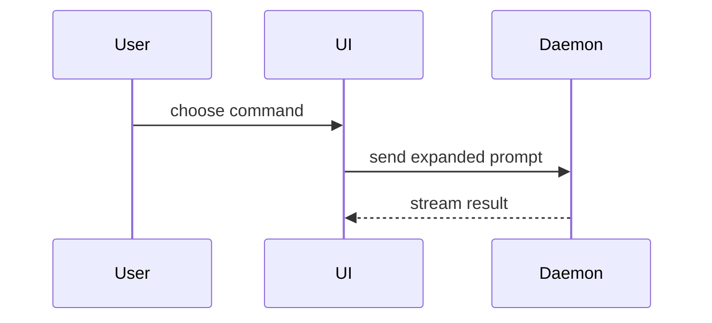
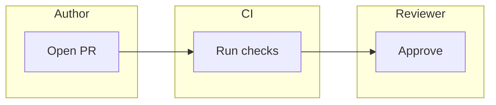

Help the user understand the current topic of conversation visually. Skip the preamble and keep prose brief. Pick the smallest view that makes the key point clear.

- Show logic or an algorithm as pseudocode:

```text
on(save)
  if content is unchanged
    return cached result
  write new content
  return fresh result
```

- Show runtime control flow as a call tree:

```text
submitForm
  createSession
    persistPrompt
    launchAgent
  navigateToSession
```

- Show UI structure as a component tree, including state and module boundaries that matter:

```tsx
<SessionPage> (apps/example/src/routes/session.tsx)
  useSessionEvents()
  <SessionToolbar>
    <RunSkillButton> (packages/ui)
```

- Show file responsibility or a broad refactor as a shallow file tree:

```text
src/
  commands/       # parses user actions
  sessions/       # owns session state
  transport/      # sends API requests
```

- Show component interaction, control flow, or data flow with Mermaid:



- Use `diff` when the point is what changes and the surrounding shape already exists. Match the diff shape to the topic.

For a component change:

```diff
 <SessionPage>
   useSessionEvents()
   <SessionToolbar>
+    <RunSkillButton />
   <SessionTimeline>
+    <SkillResultCard />
```

For a file-layout change:

```diff
 packages/api/src/schemas/
~  task.ts                           add an optional `dueDate` field
 packages/server/src/
~  tasks/reminders.ts
~    scheduleReminder                skip tasks without a due date
+    cancelReminder                  clear the reminder when a task closes
+  tasks/reminders.test.ts           closed tasks get no reminder
~  task-handler.ts                   reject due dates in the past
-  legacy-reminders.ts               folded into tasks/reminders.ts
~ apps/mobile/**/Generated/          regenerate from task.ts
 packages/web/src/tasks/
~  TaskRow.tsx
~    <TaskRow>                       show the due date
-    <OverdueBadge>                  replaced by the overdue variant of <TaskStatus>
~  locales/*/tasks.json              add due date strings
```

For a call-tree or call-stack change:

```diff
 submitForm
   createSession
     persistPrompt
+    expandSkillMention
     launchAgent
-  navigateToSession
+  navigateToSession
+    subscribeToEvents
```

For a state or control-flow change:

```diff
 on(save)
-  write content
+  if content is unchanged
+    return cached result
+  write new content
+  invalidate cache
```

- Show the whole block when most of it is new, when omitted context would hide ownership or order, or when the user needs a copyable target shape:

```ts
function expandSkill(command: string): string {
  const skillName = command.slice(1)
  return `use the ${skillName} skill`
}
```

- For a visual UI, layout, state comparison, or concept too dense for Mermaid, write one focused HTML file — a diagram, an infographic, or a short slide deck, whichever fits the point. Match the product's colors, type, spacing, and components; use real labels and data; support desktop and mobile. Then open it for the user:

```
Bash(open path/to/show-me-{description}.html)
```

### Render Visuals in the Chat Stream

Use `<json-render>` blocks in assistant messages when a visual materially helps understanding. In static sites, PR descriptions, shared documents, and other files, show the same content as a Markdown table, a Mermaid diagram, raw HTML, or an image.

### Render Visuals in Droid Chat

In the desktop and web chat, choose by what the visual is:

- Charts and dashboards: a `<json-render>` block, written raw in the reply as single-line JSON, not in a code fence. Use `Card`, `Box`, `Metric`, `BarChart`, `Sparkline`, `Table`, `ProgressBar`, `StatusLine`, `Badge`, and `Timeline`. Every element has `type`, `props`, and `children`:

```text
<json-render>{"root":"ci","elements":{"ci":{"type":"Card","props":{"title":"CI this week"},"children":["kpis","runs"]},"kpis":{"type":"Box","props":{"flexDirection":"row","gap":2},"children":["pass","p95"]},"pass":{"type":"Metric","props":{"label":"Pass rate","value":"96%","trend":"up"},"children":[]},"p95":{"type":"Metric","props":{"label":"p95 duration","value":"14 min","trend":"down"},"children":[]},"runs":{"type":"BarChart","props":{"data":[{"label":"Mon","value":12},{"label":"Tue","value":9},{"label":"Wed","value":15}]},"children":[]}}}</json-render>
```

- Systems, flows, and swimlanes: Mermaid. Use a `sequenceDiagram` (above) for who calls whom, and a flowchart with one `subgraph` per lane for who does what:



- Mockups, and diagrams Mermaid can't draw, or a Mermaid diagram the user can't follow: a `<droid-visualization>` block, in place of the HTML file. Activate the `visualize` skill first and follow its rules: raw in the reply, not in a code fence, one root element with an `id`, theme variables for every color, and no network. Keep charts and dashboards in `<json-render>`, even though `visualize` prefers `<droid-visualization>` for them.

```html
<droid-visualization>
<div id="send-button" class="vis-row">
  <div class="vis-card vis-stack">
    <p class="vis-subtitle">Current · 4px radius</p>
    <button class="btn">Send</button>
  </div>
  <div class="vis-card vis-stack">
    <p class="vis-subtitle">Proposed · accent pill</p>
    <button class="btn pill">Send</button>
  </div>
</div>
<style>
  #send-button .btn { padding: 4px 10px; font: inherit; font-size: 12px; color: var(--vis-text); background: var(--vis-surface-raised); border: 1px solid var(--vis-border-strong); border-radius: 4px; }
  #send-button .pill { color: var(--vis-accent-ink); background: var(--vis-accent); border: 0; border-radius: 999px; }
</style>
</droid-visualization>
```
### guidance

Place each visual next to the short text it supports. Keep only the calls, files, props, states, and boundaries needed to answer the user's current question or the options to resolve the current discussion point.

You may use one of these, you may use several, it is unlikely you will use all of them. Use your judgement and don't overwhelm the user.
